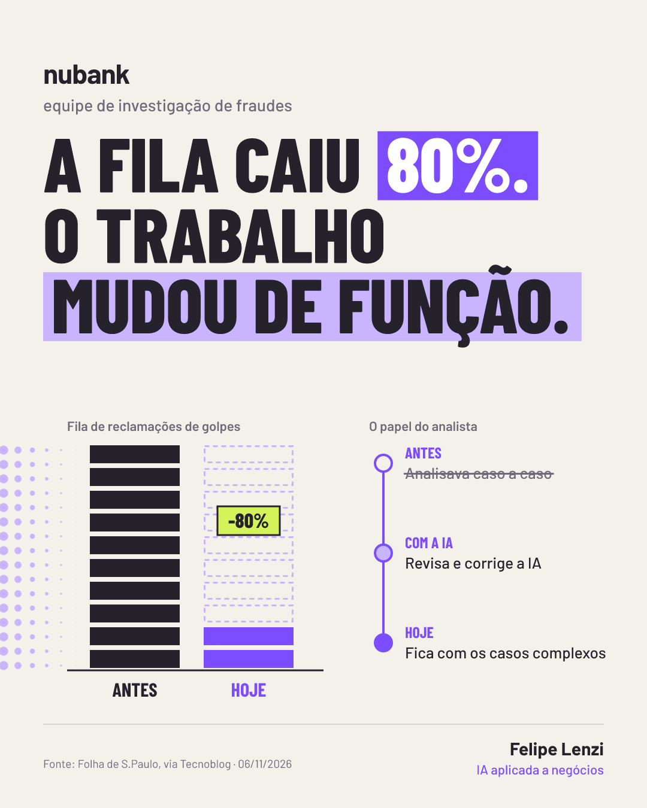
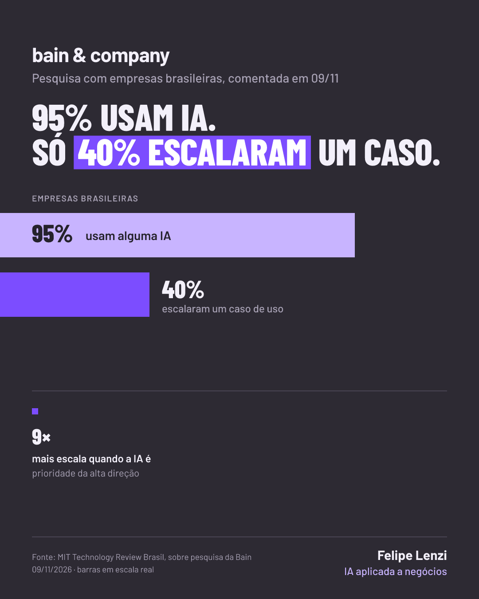
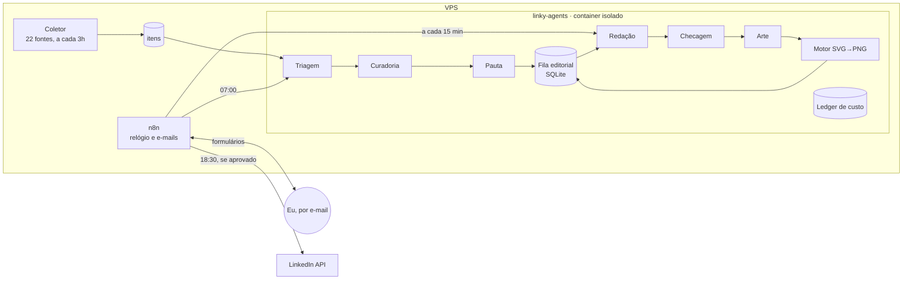

# linky

**Uma redação agêntica que todo dia escolhe, escreve, ilustra e publica um post sobre IA aplicada a negócios no meu LinkedIn. Eu só aprovo por e-mail.**


> **Em produção desde 17/11/2026**, rodando numa VPS de 2 GB que também atende a outro projeto. Este repositório público é um retrato do código de produção. O desenvolvimento acontece num repositório privado, porque o histórico de lá tem detalhes de infraestrutura.

<p align="center">
  
  
</p>
<p align="center"><sub>Artes produzidas pelo agente de arte e pelo motor de composição próprio (SVG → PNG), sem Figma nem Canva.</sub></p>

## O que eu construí

- **Uma esteira com 6 agentes tipados.** Triagem, curadoria, pauta, redação, checagem e arte, cada um com contrato Pydantic de entrada e saída, prompt versionado em `prompts/<agente>/vN.md` e fallback entre modelos (OpenAI, Anthropic e DeepSeek via `httpx`, sem SDK).
- **Teto de custo de verdade.** Cada chamada paga entra num ledger com preço por modelo. Há tetos por execução, por dia e por mês (US$ 3/mês), e o alerta chega antes de estourar. Um dia de curadoria custa cerca de US$ 0,01.
- **Um motor de composição de imagens próprio.** O agente de arte escolhe layout e componentes num espaço fechado pela identidade visual. O motor monta o SVG com shaping de texto (HarfBuzz), checa margem e colisão e rasteriza com `resvg`. Arte que viola a grade é recusada e refeita.
- **Humano no circuito, por e-mail.** De manhã chegam 3 pautas, e eu escolho uma num formulário. À tarde chega o post pronto para aprovar, com opção de hook e leitura. Os formulários usam um ID aleatório de 128 bits e um token HMAC de uso único. Sem o meu "aprovar", nada é publicado.
- **Isolamento em produção.** Um serviço HTTP interno só para o n8n, sem rota pública. Container sem privilégios, sistema de arquivos só leitura, `cap_drop: ALL` e 256 MB de RAM. Entrada só pela rede interna do n8n e saída para as APIs dos modelos conferida a cada deploy. Links de notícia passam por uma proteção contra SSRF, também nos redirecionamentos. Modo sombra para ensaiar sem publicar.
- **Decisões documentadas.** 9 ADRs, PRD, [modelo de segurança](docs/seguranca.md), glossário, playbook editorial, rubrica de avaliação e um post-mortem do primeiro dia em produção ([producao-mvp.md](docs/ideas/producao-mvp.md#incidente-de-1711-primeiro-dia-em-produção)).
- **Cerca de 440 testes offline**, com um `FakeProvider` no lugar dos modelos e sem rede. CI com `pytest` e `ruff` a cada push.

## Como funciona



| Se você quer ver… | Vá para |
|---|---|
| O harness: contratos, fallback, ledger e orçamento | [`src/linky_agents/harness/`](src/linky_agents/harness/) |
| Os agentes e os contratos entre eles | [`src/linky_agents/agents/`](src/linky_agents/agents/) e [`contracts.py`](src/linky_agents/agents/contracts.py) |
| Os prompts versionados | [`prompts/`](prompts/) |
| O motor de composição de imagens | [`src/linky_agents/render/`](src/linky_agents/render/) e [ADR 0006](docs/adr/0006-motor-de-composicao.md) |
| O serviço HTTP e a orquestração | [`src/linky_agents/service/`](src/linky_agents/service/) e [ADR 0003](docs/adr/0003-servico-http-do-harness.md) |
| Os workflows do n8n | [`n8n/`](n8n/) |
| Deploy, backup e checagem de saída | [`ops/linky/`](ops/linky/) |
| As decisões de arquitetura | [`docs/adr/`](docs/adr/) |
| O modelo de segurança (ameaças, defesas, riscos aceitos) | [`docs/seguranca.md`](docs/seguranca.md) |
| As regras editoriais (voz, playbook, rubrica) | [`docs/editorial/`](docs/editorial/) |
| O plano de produção e o post-mortem | [`docs/ideas/producao-mvp.md`](docs/ideas/producao-mvp.md) |

## Rodando localmente

Testes, lint e motor de imagens rodam sem nenhuma chave:

```bash
uv sync
uv run pytest
uv run ruff check src tests
uv run linky-render --spec examples/images/airbnb-tese.json --out data/arte.png   # arte a partir de uma especificação
```

O serviço sobe localmente com um token qualquer:

```bash
LINKY_SERVICE_TOKEN=dev uv run python -m linky_agents.service      # porta 8080, dados em data/
curl -H 'X-Linky-Token: dev' 'http://127.0.0.1:8080/agenda?n=3'
```

**O que não roda sem infraestrutura externa:** os agentes precisam de chaves de API (`OPENAI_API_KEY`, `ANTHROPIC_API_KEY`, `DEEPSEEK_API_KEY`). Os e-mails dependem do n8n e do Resend, e a publicação exige um app aprovado na API do LinkedIn. Domínios e e-mails deste repositório foram trocados por `example.com`.

## O que eu aprendi

- **"Healthy" não prova que funciona.** No primeiro dia em produção, o container estava saudável, mas numa rede sem saída para a internet. Os ensaios tinham rodado numa cópia em outra rede. Desde então, o deploy confere a saída real para cada host de modelo.
- **Contrato tipado antes de prompt.** Fixar entrada e saída de cada agente em Pydantic permitiu desenvolver as frentes em paralelo e testar tudo offline.
- **Aprovação humana barata vale mais que semanas de modo sombra.** Com o "aprovar" por e-mail como rede de segurança, o sistema foi para produção em dias e melhora toda semana com dados reais de uso.
- **Custo é requisito, não métrica.** O ledger com tetos mudou a escolha de modelos por agente: o modelo caro fica só onde a qualidade aparece no texto final.

---

Felipe Lenzi · IA aplicada a negócios
